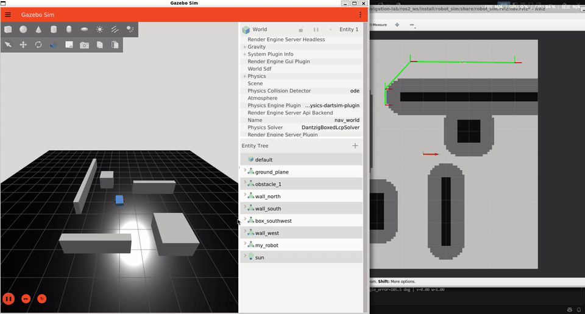

# Robot Navigation Lab：基于 ROS 2 的移动机器人导航系统

> 在 Gazebo 仿真中，从零实现 **A\* 全局规划 + P 控制器路径跟踪** 的完整导航闭环：
> 在 RViz 中点击任意目标，机器人从当前位置实时重规划，绕开障碍物到达目标并停车。



<!-- 演示动图放在 docs/media/p1_demo.gif（录制方法见 docs/media/README.md） -->

## 功能亮点

- **A\* 全局规划（自研，C++）**
  - 优先队列（最小堆）+ 懒惰删除，格子状态用数组索引 O(1) 访问
  - 8 邻域 + octile 启发函数，禁止斜穿障碍物拐角
  - 路径拉直：基于精确格子遍历（Amanatides-Woo）的视线检查，得到任意角度的少量路径点
  - 障碍物膨胀：按机器人外接圆半径 + 安全余量生成不可通行区域
- **路径跟踪**：P 控制器（角度误差大时原地转向），逐个路径点切换，到达终点后**原地转到 RViz 指定的朝向**再停车；
  收到新路径即切换，收到空路径（任务取消）立即停车；Ctrl+C 退出时自动发零速度
- **交互与可视化**：RViz 显示栅格地图（障碍物 / 膨胀区）、规划路径、机器人位姿；
  用 **2D Goal Pose** 设定目标，无效目标（障碍物内 / 地图外）会被拒绝
- **参数化场景**：地图尺寸、分辨率、障碍物、默认目标都在 YAML 中配置，换场景无需改代码
- **测试与性能数据**：15 个 GoogleTest 单元测试；性能对比程序

## 性能

优化版 A\* 与第一版（vector 存 open/closed set、每步线性查找）对比，Release 编译，取多次运行中位数：

| 场景 | 第一版 | 优化版（4 邻域） | 提速 | 8 邻域路径缩短 |
|---|---|---|---|---|
| nav_world 100×100（0.1 m） | 3.75 ms | 0.13 ms | **30×** | 14% |
| nav_world 200×200（0.05 m） | 63.8 ms | 0.63 ms | **101×** | 14% |
| 随机障碍物 200×200（25%） | 177 ms | 0.42 ms | **421×** | 17% |

运行：`ros2 run path_planner benchmark_astar`（数值随机器不同而变化）

## 系统架构

```
                 /model/my_robot/odometry, /tf
  Gazebo ──── ros_gz_bridge ──────────────┬───────────────────────┐
  (小车)                                  ↓                       ↓
    ↑                              path_publisher  ─/planned_path→  path_follower
    │                              (A* 规划节点)                    (P 控制器)
    │                               │ /map    ↑ /goal_pose            │
    │                               ↓         │                       │
    │                              RViz ──────┘                       │
    └──────────── ros_gz_bridge ←──────── /cmd_vel ───────────────────┘
```

| 包 | 内容 |
|---|---|
| `path_planner` | `GridMap`（栅格地图、膨胀）、A\*、路径拉直、规划节点 `path_publisher`、性能对比 `benchmark_astar`、单元测试 |
| `robot_control` | P 控制器 `computeVelocity`、路径跟踪节点 `path_follower`、单目标点控制器 `go_to_goal` |
| `robot_sim` | Gazebo 世界（`nav_world.sdf`）、场景参数（`config/nav_world.yaml`）、launch 文件、RViz 配置 |

| 话题 | 类型 | 方向 |
|---|---|---|
| `/model/my_robot/odometry` | `nav_msgs/Odometry` | Gazebo → 规划、跟踪、RViz |
| `/goal_pose` | `geometry_msgs/PoseStamped` | RViz → 规划 |
| `/planned_path` | `nav_msgs/Path` | 规划 → 跟踪、RViz（1 Hz 重复发布；空路径 = 取消） |
| `/map` | `nav_msgs/OccupancyGrid` | 规划 → RViz（transient_local，只发一次） |
| `/cmd_vel` | `geometry_msgs/Twist` | 跟踪 → Gazebo |

## 环境

- Ubuntu 26.04（WSL 2）、ROS 2 Lyrical、Gazebo Sim 10、`ros_gz`
- C++17、CMake、GoogleTest

## 快速开始

```bash
cd ros2_ws
colcon build
source install/setup.bash
ros2 launch robot_sim nav_demo.launch.py
```

启动后 Gazebo 和 RViz 同时打开，机器人自动开往默认目标 (4, 4)。
之后在 RViz 工具栏点 **2D Goal Pose**，在地图上按住左键拖动后松开，即可设定新目标。

> WSL 用户：launch 文件已为 RViz 设置 `QT_QPA_PLATFORM=xcb`。单独启动 RViz 时请使用
> `QT_QPA_PLATFORM=xcb rviz2`，否则会因 Wayland / X11 不匹配而崩溃。

### 单元测试

```bash
colcon test --packages-select path_planner
colcon test-result --verbose
```

### 常用参数（`robot_sim/config/nav_world.yaml`）

| 参数 | 默认 | 说明 |
|---|---|---|
| `goal_x`, `goal_y` | 4.0, 4.0 | 启动后的默认目标 |
| `allow_diagonal` | true | 8 邻域 / 4 邻域 |
| `robot_radius` + `safety_margin` | 0.47 + 0.1 | 膨胀半径 |
| `map.resolution` | 0.1 | 栅格分辨率（m） |
| `obstacle_names`, `<name>.center`, `<name>.size` | — | 障碍物列表（须与 `nav_world.sdf` 一致） |

## 局限与改进方向

- 假设 odom 与 world 坐标系重合（机器人出生在原点、朝向 0），尚未用 TF 做通用变换
- 地图是预先给定的，没有传感器感知；无法处理动态障碍物
- 障碍物同时写在 SDF 和 YAML 中，需人工保持一致（计划改为由 YAML 生成 SDF）
- 路径跟踪是逐点 P 控制，拐角处需停下转向；可改为 Pure Pursuit 等平滑跟踪算法

后续计划：激光雷达 + SLAM 建图 + Nav2，以及把自研 A\* / Pure Pursuit 做成 Nav2 插件（见 [PLAN.md](PLAN.md)）。

## 仓库结构

```
robot-navigation-lab/
├── ros2_ws/src/
│   ├── path_planner/     # 规划
│   ├── robot_control/    # 控制
│   └── robot_sim/        # 仿真场景与启动
├── practice/             # 学习过程中的小练习
├── PLAN.md / LEARNING.md # 学习计划与进度
└── *.cpp                 # 早期 C++ 基础练习
```
