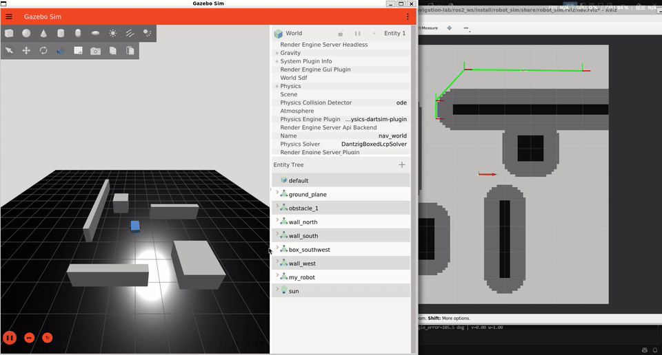

# P1 项目文档：基于 ROS 2 的移动机器人 A* 导航系统

> 读法建议：不用一次读完。可以按"第 1–5 节（整体）→ 第 6 节（模块，一次读 1–2 个）→ 第 7–10 节（经验与面试）"分 2–3 次读。
> 读的时候把不懂的地方记下来，读完至少提 3 个问题。

## 目录
1. [一句话介绍](#1-一句话介绍)
2. [演示效果](#2-演示效果)
3. [系统架构](#3-系统架构)
4. [节点 / 话题 / 参数](#4-节点--话题--参数)
5. [数据流：点一下目标之后发生了什么](#5-数据流点一下目标之后发生了什么)
6. [模块逐个讲解](#6-模块逐个讲解)
7. [关键参数与调参经验](#7-关键参数与调参经验)
8. [踩过的坑](#8-踩过的坑)
9. [局限与改进方向](#9-局限与改进方向)
10. [面试问答](#10-面试问答)

---

## 1. 一句话介绍

**口头版（自我介绍时用）：**
> 我用 ROS 2 和 Gazebo 从零实现了一个移动机器人导航系统：在 RViz 里点击目标，机器人用自己写的 A* 从当前位置规划路径，再用 P 控制器跟踪路径，绕开障碍物到达目标。

**简历版：**
> **基于 ROS 2 的移动机器人自主导航系统**（C++ / ROS 2 / Gazebo）
> - 自研 A* 全局规划：优先队列 + 懒惰删除、数组索引、8 邻域 octile 启发、障碍物膨胀与视线拉直；相比初版提速 30–421 倍，路径缩短 14–17%
> - 实现 P 控制器路径跟踪与 RViz 交互式目标设定，支持实时重规划、无效目标拒绝、仿真重置自动恢复
> - 场景参数化（YAML），15 个 GoogleTest 单元测试与性能对比程序

---

## 2. 演示效果



（4 倍速，约 48 秒）左边 Gazebo 是"真实世界"，右边 RViz 是"机器人认为的世界"：黑色是障碍物，深灰是膨胀区，绿线是规划路径，红箭头是机器人。

---

## 3. 系统架构

```
                    /model/my_robot/odometry（位置）、/tf（坐标变换）
  Gazebo ─── ros_gz_bridge ──────────────┬──────────────────────────┐
  (仿真)                                 ↓                          ↓
    ↑                             path_publisher ──/planned_path──→ path_follower
    │                             （规划节点）                      （跟踪节点）
    │                              │ /map        ↑ /goal_pose            │
    │                              ↓             │                       │
    │                             RViz ──────────┘                       │
    │                          （显示 + 点目标）                          │
    └─────────── ros_gz_bridge ←────────── /cmd_vel（速度命令）───────────┘
```

**三个"角色"各管一件事：**

| 角色 | 负责 | 只关心 |
|---|---|---|
| **规划节点** `path_publisher` | 想"走哪条路" | 地图、机器人在哪、目标在哪 |
| **跟踪节点** `path_follower` | 管"怎么走过去" | 路径、机器人在哪、朝向哪 |
| **Gazebo** | 模拟真实世界的物理 | 速度命令 |

**为什么分成两个节点？** 规划慢、偶尔做一次（换目标时）；跟踪快、一直在做（每 0.1 秒）。分开以后各自独立运行，以后想换一个更好的规划算法或控制算法，只换一个节点就行，另一个不用动。这叫**模块化 / 解耦**。

**ROS 2、Gazebo、RViz 的关系：** ROS 2 是通信框架（话题、消息的规则）；RViz 是一个 ROS 节点；Gazebo 是独立软件、不懂 ROS 消息，靠 `ros_gz_bridge` 翻译。RViz 和 Gazebo 之间**从不直接通信**——所以 RViz 显示的是"ROS 节点认为的世界"，不一定是 Gazebo 里的真实世界。

---

## 4. 节点 / 话题 / 参数

### 4.1 节点

| 节点 | 包 | 作用 |
|---|---|---|
| `path_publisher` | path_planner | 读取地图参数，规划路径，发布 `/map` 和 `/planned_path` |
| `path_follower` | robot_control | 跟踪路径，发布 `/cmd_vel` |
| `parameter_bridge` | ros_gz_bridge | ROS ↔ Gazebo 消息翻译 |
| `static_transform_publisher` | tf2_ros | 发布 world → my_robot/odom 的固定坐标变换 |
| `rviz2` | rviz2 | 可视化、设定目标 |

### 4.2 话题

| 话题 | 消息类型 | 发布者 → 订阅者 | 说明 |
|---|---|---|---|
| `/model/my_robot/odometry` | `nav_msgs/Odometry` | Gazebo → 规划、跟踪、RViz | 机器人位置（x, y）和朝向（四元数） |
| `/tf` | `tf2_msgs/TFMessage` | Gazebo → RViz | my_robot/odom → my_robot/chassis |
| `/goal_pose` | `geometry_msgs/PoseStamped` | RViz → 规划 | 用户点击的目标 |
| `/map` | `nav_msgs/OccupancyGrid` | 规划 → RViz | 栅格地图；QoS 为 transient_local，只发一次 |
| `/planned_path` | `nav_msgs/Path` | 规划 → 跟踪、RViz | 每秒重复发布；**空路径表示"取消任务"** |
| `/cmd_vel` | `geometry_msgs/Twist` | 跟踪 → Gazebo | `linear.x` 前进速度，`angular.z` 转向速度 |

### 4.3 坐标系

```
world ──(静态变换，平移 0 旋转 0)──→ my_robot/odom ──(Gazebo 实时发布)──→ my_robot/chassis
```
机器人出生在 world 原点、朝向 0，所以 odom 和 world 重合。**本项目直接把里程计坐标当成 world 坐标用**——这是一个有意的简化假设（见第 9 节）。

### 4.4 主要参数（`robot_sim/config/nav_world.yaml`）

| 参数 | 值 | 含义 |
|---|---|---|
| `goal_x`, `goal_y` | 4.0, 4.0 | 启动后自动规划的默认目标 |
| `allow_diagonal` | true | 8 邻域（可斜走） |
| `robot_radius` | 0.47 m | 车身 0.8 × 0.5 m 的外接圆半径 √(0.4² + 0.25²) ≈ 0.47 |
| `safety_margin` | 0.1 m | 额外安全余量；膨胀半径 = 0.47 + 0.1 = 0.57 m |
| `map.*` | 100 × 100，0.1 m，原点 (-5, -5) | 覆盖 10 × 10 m |
| `obstacle_names` + `<名字>.center/size` | 5 个障碍物 | 必须和 `nav_world.sdf` 一致 |

控制器参数（代码中 `ControllerParams` 的默认值）：`k_linear = 0.5`、`k_angular = 1.5`、`max_linear = 0.3 m/s`、`max_angular = 1.0 rad/s`、`turn_in_place_angle = 0.5 rad（约 29°）`；跟踪节点：`waypoint_tolerance = 0.15 m`、`goal_tolerance = 0.1 m`。

---

## 5. 数据流：点一下目标之后发生了什么

以"机器人在 (0, 0)，在 RViz 里点 (4, 4)"为例：

1. **RViz** 把点击位置打包成 `PoseStamped`，发到 `/goal_pose`。
2. **规划节点** `goalCallback` 收到 → 检查坐标是不是有效数字 → 调用 `planTo(4, 4)`。
3. `planTo` 把机器人位置 (0, 0) 和目标 (4, 4) 转成**格子编号**（`worldToGrid`），检查：都在地图内？目标不在障碍物或膨胀区里？机器人不在障碍物格子里？任何一项不满足 → 发布**空路径**（取消任务）。
4. 调用 **A\***，得到 87 个格子组成的路径（约 0.7 毫秒）。
5. **路径拉直** `smoothPath`：87 个格子 → 5 个点；去掉起点格子（机器人已经在那里），最后一个点换成精确的 (4, 4) → 4 个路径点。
6. 打包成 `nav_msgs/Path` **立刻发布**，之后每秒再重复发布一次。
7. **跟踪节点** `pathCallback` 收到 → 和当前路径比较内容，不同 → 换成新路径，从第 1 个点开始。
8. **跟踪节点** `controlLoop` 每 0.1 秒：读当前位置/朝向 → 算到当前路径点的距离和角度误差 → `computeVelocity` 算出速度 → 发布 `/cmd_vel`。
9. 距离小于 0.15 m → 换下一个路径点；最后一个点距离小于 0.1 m → 发零速度，停车。
10. 同时，**Gazebo** 收到 `/cmd_vel` 让轮子转动，算出新位置发回 `/model/my_robot/odometry`，回到第 8 步——这就是**闭环**。

---

## 6. 模块逐个讲解

### 6.1 栅格地图 `GridMap`（grid_map.hpp / .cpp）

**作用：** 把连续的世界切成一个个小方格，每格记一个数字：

| 值 | 常量 | 含义 |
|---|---|---|
| 0 | `kFree` | 空闲 |
| 50 | `kInflated` | 膨胀区：没有障碍物，但机器人**中心**不能进来 |
| 100 | `kOccupied` | 障碍物 |

这套数字和 ROS 的 `OccupancyGrid` 约定一致，所以可以直接发给 RViz 显示。

**坐标转换：**
```cpp
col = floor((x - origin_x) / resolution);   // 世界坐标 → 格子
row = floor((y - origin_y) / resolution);
x = origin_x + (col + 0.5) * resolution;    // 格子 → 世界坐标（取格子中心）
```
注意 **x 对应列（col），y 对应行（row）**。

**数据存储：** 二维地图存在一维 `vector` 里，`index = row * width + col`（行优先）。

**障碍物膨胀 `inflate(radius)`——为什么需要：** A* 把机器人当成一个"点"来规划，但真实的车身有 0.8 × 0.5 m。把障碍物向外扩大"车身半径 + 余量"，只要机器人**中心**不进入膨胀区，车身就碰不到障碍物。这样复杂的"车身形状"问题就变成了简单的"点"问题。

**实现要点：**
```cpp
const std::vector<int8_t> original = data_;      // ① 先复制一份原图
...
double gap_row = std::max(0.0, std::abs(dr) - 0.5);   // ② 到障碍物格子"方块"的距离
double gap_col = std::max(0.0, std::abs(dc) - 0.5);
double distance = std::hypot(gap_row, gap_col) * resolution_;
if (distance <= radius && ... == kFree) data_[...] = kInflated;   // ③ 只标空闲格
```
- ① 只从**原始**障碍物向外扩；否则新标记的格子又会被当成障碍物继续扩，越扩越大。
- ② 算的是到障碍物格子**整个方块**的距离（减 0.5 是半个格子），而不是到格子中心的距离——否则会漏掉障碍物的拐角（见第 8 节坑 9）。
- ③ 不覆盖真正的障碍物，这样 RViz 里能分清黑色和深灰色。

### 6.2 A* 规划（astar_planner.hpp / .cpp）

**A\* 在做什么：** 从起点开始，一圈圈"试探"周围的格子，每次挑**最有希望**的那个继续试，直到碰到终点。

**三个数：**
- **g**：从起点到这个格子**已经走了**多远（确定的）
- **h**：从这个格子到终点**估计还要**多远（启发函数）
- **f = g + h**：走这个格子，全程**大概**多远。每次挑 f 最小的。

**启发函数：**

| 函数 | 用于 | 公式 |
|---|---|---|
| 曼哈顿 `manhattanHeuristic` | 4 邻域 | \|dx\| + \|dy\| |
| octile `octileHeuristic` | 8 邻域 | (dx + dy) + (√2 − 2) × min(dx, dy)，即"先斜走 min 步，再直走剩下的" |

**唯一的规则：不能高估**（h ≤ 真实剩余距离），否则 A* 可能错过最短路。两者都是"没有障碍物时的最短距离"，不会高估。在不高估的前提下，越接近真实值，A* 试探的格子越少、越快——所以 8 邻域用 octile 而不是直线距离。

**四个工程优化（相对第一版 `astar_basic.cpp`）：**

| 优化 | 第一版 | 优化版 | 复杂度 |
|---|---|---|---|
| 取 f 最小 | `vector` 从头比到尾 | `std::priority_queue` 最小堆 | O(n) → O(log n) |
| 查"处理过吗 / g 是多少" | 遍历 closed set | `closed[编号]`、`g_cost[编号]` | O(n) → O(1) |
| 更新已在队列中的格子 | 找到它直接改 | **懒惰删除**：再放一条新记录，旧记录取出时跳过 | — |
| 邻域 | 4 方向 | 8 方向 + 禁止斜穿拐角 | 路径缩短 14–17% |

**核心循环（简化）：**
```cpp
open_set.push({h(start), h(start), start});
while (!open_set.empty()) {
    OpenItem current = open_set.top();  open_set.pop();
    if (closed[current.index]) continue;        // 懒惰删除：过时记录，跳过
    closed[current.index] = true;
    if (current.index == goal) return 顺着 parent 回溯的路径;

    for (每个方向 d) {
        if (邻居出界 / 不可通行) continue;
        if (斜向 && 两侧有一格不可通行) continue;   // 禁止斜穿拐角
        if (closed[next]) continue;
        double new_g = g_cost[current] + (斜向 ? √2 : 1);
        if (new_g < g_cost[next]) {               // 只在找到更短的路时才放
            g_cost[next] = new_g;  parent[next] = current;
            open_set.push({new_g + h, h, next});
        }
    }
}
return {};   // 队列空了还没到终点：无路径
```

**为什么懒惰删除是对的：** 同一个格子在堆里可能有几条记录。堆总是先取 f 最小的，所以第一次取出时用的就是到它的**最短**路；之后再取出的旧记录只会更差，扔掉不会丢失任何更好的信息。

**比较器的小坑：** `std::priority_queue` 默认是**最大堆**。我们自定义 `OpenItemGreater` 反过来比较，让 f 最小的在顶上；f 相同时 h 小的优先（离终点更近，少试几个格子）。

**为什么禁止斜穿拐角：** 两个障碍物斜着挨在一起时，中间只有一个"点"的缝，斜着走过去车身会擦到两边。

### 6.3 路径拉直 `smoothPath` 与视线检查 `hasLineOfSight`

**问题：** 8 邻域只能走 0° / 45° / 90°……在细格子上，绕障碍物时会出现很多 0.1 m 的小折角，机器人会频繁停下转向。

**思路：** 从当前保留点出发，往后找**最远**的一个能"直线看到"的点（两点连线经过的格子全部可通行），中间的点全部跳过；然后从那个点继续。结果是**少量、任意角度**的路径点（实测 87 格 → 5 点）。

**视线检查用 Amanatides-Woo 算法：** 沿着线段走，每跨过一条格子边界就进入下一个格子，保证线段经过的**每一个**格子都被检查到；线段恰好穿过格子角点时，要求两侧的格子都可通行（和 A* 禁止斜穿拐角一致）。

> 早期版本是"每隔 0.2 格采样一次"，代码审查发现线段擦过格子一角时可能正好漏检（见第 8 节坑 11）。

### 6.4 规划节点 `path_publisher`（path_publisher.cpp）

**启动时：** 读参数 → 构建地图（`loadObstacles` 按名字读每个障碍物的 center/size）→ 膨胀 → 发布 `/map` → 订阅里程计和 `/goal_pose` → 开 1 秒定时器重复发布路径。

**各回调做什么：**

| 回调 | 触发 | 做什么 |
|---|---|---|
| `odomCallback` | 每条里程计（约 20 次/秒） | 记录机器人位置；第一次收到时规划默认目标；**检测仿真重置**（时间戳倒退 → 重新规划当前目标） |
| `goalCallback` | RViz 点目标 | 检查坐标有效 → `planTo` |
| `publishPath`（定时器） | 每秒 | 更新时间戳，重复发布当前路径 |

**两个设计点：**
- **空路径 = 取消任务。** 目标无效时如果什么都不发，跟踪节点会继续执行**旧任务**；发一条空路径，跟踪节点就明确知道"该停车了"。
- **每秒重复发布路径。** 后启动的订阅者（比如晚开的 RViz）最多等 1 秒就能收到；而地图只发一次，所以地图用 `transient_local`。

### 6.5 P 控制器 `computeVelocity`（controller.hpp / .cpp）

**输入：** 到目标点的距离 `distance`、角度误差 `angle_error`。**输出：** 线速度 `linear`、角速度 `angular`。

```cpp
cmd.angular = clamp(k_angular * angle_error, -max_angular, max_angular);
if (|angle_error| > turn_in_place_angle)  cmd.linear = 0;                 // 先原地转
else                                      cmd.linear = min(k_linear * distance, max_linear);
```

- **P（比例）控制：** 误差越大，命令越大；误差越小，越温和——接近目标时自然减速，不会冲过头。
- **限幅（clamp）：** 防止误差大时速度过大。
- **先转后走：** 车头偏得太多时一边走一边转会画出大弧线、甚至背离目标；先原地转到大致对准，再前进。

**角度误差怎么算：**
```cpp
yaw = atan2(2(wz + xy), 1 − 2(y² + z²));                 // 四元数 → 朝向角
angle_error = normalizeAngle(atan2(dy, dx) − yaw);       // 目标方向 − 车头方向，再归一化到 [-π, π]
```
- 用 `atan2` 而不是 `atan`：能区分四个象限、不会除以零。
- **必须归一化：** 170° − (−170°) 不归一化是 340°（绕一大圈），归一化后是 −20°（走近路）。

### 6.6 跟踪节点 `path_follower`（path_follower.cpp）

**状态（成员变量）：** 当前位置 `x_, y_, yaw_`；路径点列表 `waypoints_`；当前目标点编号 `current_index_`；是否完成 `finished_`。

**为什么用类写节点：** 里程计回调和控制循环要共享数据（位置），放在成员变量里最规范。

**两个回调分工：**
- `odomCallback`：**只存数据**（位置、朝向），很快执行完；
- `controlLoop`（100 ms 定时器）：**计算和决策**，以固定 10 Hz 运行，不受消息到达快慢影响。

**收到路径时（`pathCallback`）：**

| 收到 | 含义 | 处理 |
|---|---|---|
| 和当前一样的路径 | 规划节点的每秒重复发布 | 忽略（否则每秒都被拉回第一个点） |
| 不一样的路径 | 新任务 | 替换，从第 1 个点开始 |
| 空路径 | 任务取消 | 停车、清空 |

**到达后转到目标朝向（第 ⑥ 步"改一个功能"，2026-10-24 由我自己实现）：**
- 规划节点在 `goalCallback` 里保存 RViz 箭头的朝向（四元数），写进路径**最后一个点**的 `orientation`；
- 跟踪节点收到路径时用 `quaternionToYaw` 算出目标 yaw；到达终点位置后进入**转向阶段**（`rotating_ = true`），
  之后只看朝向误差 `normalizeAngle(goal_yaw − yaw)`：绝对值 < 0.05 rad（约 3°）才停车，否则 `computeVelocity(0, 误差)` 只转不走；
- 用"阶段标记"而不是每轮重新判断距离：原地转时位置会轻微漂移，避免小车又开始前进（最简单的**状态机**：行驶 → 转向 → 完成）；
- 踩坑：判断到位时漏写 `std::abs`，需要顺时针转（误差为负）时会立刻"到位"而不转。

**安全设计：**
- 按 Ctrl+C 退出时，在 `pre_shutdown` 回调里先发零速度（Gazebo 的差速插件会一直保持最后一个速度）；
- 检测到仿真重置（里程计时间戳倒退）：停车并清空旧路径，等新路径。

### 6.7 仿真与启动（robot_sim）

| 文件 | 作用 |
|---|---|
| `worlds/nav_world.sdf` | Gazebo 世界：地面、5 个障碍物、差速驱动小车 `my_robot` |
| `config/nav_world.yaml` | 规划参数：地图、障碍物、默认目标、膨胀半径 |
| `launch/sim.launch.py` | 启动 Gazebo + 桥接；启动参数 `world` 选择世界文件 |
| `launch/nav_demo.launch.py` | 一键启动：sim + 静态 TF + 规划 + 跟踪 + RViz |
| `rviz/nav.rviz` | RViz 显示配置 |

**桥接的方向符号：** `]` 是 ROS → Gazebo（`/cmd_vel`），`[` 是 Gazebo → ROS（里程计、TF），`@` 是双向。

---

## 7. 关键参数与调参经验

| 参数 | 调大 | 调小 |
|---|---|---|
| `safety_margin`（膨胀） | 离障碍物更远、更安全；但窄通道会被堵死（实验：0.3 时小车被困原地，哪都去不了） | 路径贴着障碍物，容易擦碰 |
| `map.resolution` | 计算更快；但障碍物和膨胀区被"放大"到整格，窄处误判为不可通行（0.5 m 时 (-4,-4) 不可达） | 更精确；格子数 ∝ 1/分辨率²，计算量变大（A* 优化后 0.1 m 也不到 1 ms） |
| `k_angular` | 转得快；过大会在目标方向附近左右摆动（振荡） | 转得慢、反应迟钝 |
| `turn_in_place_angle` | 更少原地转，边走边转的弧线更大 | 更多停下转向，路线更"折" |
| `waypoint_tolerance` | 更早切到下一个点，过弯更顺；过大会"抄近路"偏离路径 | 每个点都精确经过，但会在点附近减速 |

---

## 8. 踩过的坑

> 面试常问"项目中遇到过什么问题、怎么解决的"。格式：**现象 → 原因 → 解决**。

| # | 现象 | 原因 | 解决 / 收获 |
|---|---|---|---|
| 1 | `ros2 launch` 报找不到包 `robot_sim` | 新终端只 source 了系统 ROS（underlay），没 source 工作空间（overlay） | 每个新终端：`ros2on` + `source install/setup.bash` |
| 2 | 编译"成功"，但 `No executable found` | VS Code 文件没保存，硬盘上的 CMakeLists 根本没有新目标 | 开启自动保存；"编译成功但找不到"先查输入文件 |
| 3 | `.gitignore` 写了也没用，一直显示 modified | `.gitignore` 只对**未跟踪**文件生效 | `git rm --cached` 停止跟踪 |
| 4 | y 坐标取成了 `position.z`，测试却"通过" | 测试只让小车原地转，y 和 z 一直都是 0 | **测试要覆盖每个可能出错的量** |
| 5 | Ctrl+C 关掉控制节点后小车继续开 | Gazebo 差速插件保持最后一次收到的速度 | 在 pre_shutdown 回调里发零速度 |
| 6 | Gazebo Reset 后节点不再工作 | 规划只做一次、跟踪完成后锁定 | M2：从当前位置重规划、按内容判断新路径 |
| 7 | RViz 一启动就崩溃（WSL） | Qt 用 Wayland 开窗口，OGRE 用 X11 画图，不匹配 | `QT_QPA_PLATFORM=xcb` |
| 8 | 后启动的 RViz 收不到地图 | 地图只发一次，晚加入的订阅者错过了 | QoS 设为 `transient_local` |
| 9 | 早期膨胀会漏掉障碍物拐角 | 用"格子中心到格子中心"的距离，障碍物格子本身有半格宽 | 改为到障碍物格子方块的距离（减 0.5 格） |
| 10 | Reset 后小车直线冲向旧路径点、撞墙卡住 | 节点不知道仿真被重置，还在跟踪旧路径的后半段 | 里程计时间戳倒退 → 规划节点重规划、跟踪节点清空旧路径（**用户实测发现**） |
| 11 | 视线检查可能让拉直后的路径擦过障碍物一角 | 每 0.2 格采样，线段擦角不足 0.2 格时漏检（代码审查发现，反例：(0,0)→(7,11) 擦过 (2,2)） | 改用 Amanatides-Woo 精确格子遍历，并把反例写进单元测试 |
| 12 | 性能测试数字偏慢 | colcon 默认不开编译优化 | CMake 默认 `Release` |
| 13 | 需要顺时针转向时，小车到达后不转就停 | 朝向误差为负，`误差 < 阈值` 恒成立 | 比较前取绝对值 `std::abs(误差) < 阈值`（和 `computeVelocity` 里同理） |
| 14 | 同一位置第三次点目标、只换朝向，小车不转 | 跟踪节点只比较路径点位置；小车已在终点时新旧路径都是 [终点]，被当成重复发布忽略（有时出现、有时不出现） | "是否新任务"同时比较路径点**和目标朝向**；先比较、再更新 `goal_yaw_` |

---

## 9. 局限与改进方向

| 局限 | 影响 | 改进方向 |
|---|---|---|
| 假设 odom = world | 机器人出生点不在原点就会错 | 用 TF2 查询 world → base 变换（P4） |
| 地图预先给定，没有传感器 | 不能处理未知或移动的障碍物 | 激光雷达 + SLAM 建图 + 局部避障（P4） |
| 障碍物在 SDF 和 YAML 各写一份 | 改一边忘改另一边，规划地图和真实世界不一致 | 由 YAML 自动生成 SDF（单一数据源，P1 第 ⑥ 步） |
| 逐点 P 控制 | 拐角处要停下转向，不够平滑 | Pure Pursuit 等平滑跟踪算法（P6） |
| 机器人卡进障碍物格子后拒绝规划 | 只能重启 | 允许从膨胀区 / 障碍物格子"脱困"的规划 |
| 只规划一次、不检测偏离 | 被推开或打滑后仍去追原路径点 | 偏离路径过远时自动重规划 |
| 膨胀用外接圆 | 对长条形车身偏保守 | 按真实车身轮廓做碰撞检测 |

---

## 10. 面试问答

> 先自己想答案，再看参考。回答用"结论 + 原因 + 例子"。

**Q1. 简单介绍一下这个项目。**
> 见第 1 节口头版。可以接着说三个亮点：A* 优化的数据、交互式重规划、自己发现并修复的 Reset bug。

**Q2. A* 和 Dijkstra 有什么区别？**
> Dijkstra 只看 g（已走距离），向四周均匀扩展；A* 多了启发函数 h，优先朝终点方向搜索，所以通常试探的格子少得多。h 恒为 0 时，A* 就退化成 Dijkstra。

**Q3. 启发函数为什么不能高估？**
> A* 在终点被取出时就结束，依据是"f 是这条路的下界"。h 高估会让最短路上的点 f 偏大、被推迟处理，A* 可能先用一条较长的路到达终点并结束，错过最短路。不高估时偏小只是慢一点，结果一定最短。

**Q4. 你的 A* 用了哪些优化？复杂度怎样？**
> 优先队列取最小 f（O(n) → O(log n)）；数组按格子编号存 g、parent、closed（查找 O(1)）；懒惰删除代替在堆中修改。整体约 O(n log n)，n 为格子数。实测 100×100 快 30 倍，200×200 随机地图快 421 倍。

**Q5. 什么是懒惰删除？为什么正确？**
> 找到更短的路时不去修改堆里的旧记录，而是再放一条新记录；旧记录被取出时发现格子已关闭就跳过。正确是因为堆总是先取 f 最小的，同一格子第一次被取出的就是最短的那条。

**Q6. 4 邻域和 8 邻域有什么区别？8 邻域要注意什么？**
> 8 邻域可以斜走（代价 √2），路径更短（本项目短 14–17%），启发函数要换成 octile；要禁止斜穿两个障碍物之间的拐角，否则车身会擦碰。

**Q7. 机器人有体积，A* 把它当成点，怎么处理？**
> 障碍物膨胀：按车身外接圆半径加安全余量扩大障碍物，机器人中心不进入膨胀区就不会碰撞。代价是窄通道可能被堵（实验中余量 0.3 m 时机器人被困）。

**Q8. 路径为什么要拉直？怎么做的？**
> 栅格路径方向受限、折点多，机器人频繁停下转向。从每个保留点向后找最远的可直视点，跳过中间点；视线检查用 Amanatides-Woo 精确遍历线段经过的格子。87 格的路径变成 5 个路径点。

**Q9. 讲讲你的路径跟踪控制器。**
> P 控制：角速度与角度误差成正比，线速度与距离成正比，都有上限；角度误差大于约 29° 时先原地转向。10 Hz 运行；离中间点 0.15 m 内切换下一个，离终点 0.1 m 内停车。

**Q10. 角度误差为什么要归一化？为什么用 atan2？**
> 角度相减可能超出 ±180°，比如 −170° − 170° = −340°，不归一化会绕一大圈；归一化后是 +20°。atan2 根据两个参数的正负号返回完整的 ±180° 角度，atan 只有 ±90° 且可能除以零。

**Q11. 规划节点和跟踪节点怎么配合？为什么跟踪节点要比较路径内容？**
> 规划节点每秒重发同一条路径。跟踪节点如果每收到一条就从第一个点重新开始，会每秒被拉回去、永远到不了终点；所以只有内容变化才切换。另外约定空路径表示取消任务。

**Q12. 为什么地图用 transient_local QoS，路径不用？**
> 地图只发一次，晚启动的 RViz 会错过，transient_local 让发布者保留最后一条消息给后来的订阅者；路径每秒重发，最多等 1 秒就能收到。

**Q13. 遇到过印象最深的 bug 是什么？**
> Gazebo Reset 后机器人直线撞墙：两个节点不知道仿真重置了，跟踪节点还在追旧路径后段的点。通过检测里程计时间戳倒退识别重置，规划节点从新位置重规划，跟踪节点清空旧路径。（第 8 节还有很多可选。）

**Q14. 怎么保证优化后的 A* 是对的？**
> 15 个 GoogleTest 单元测试：空地图路径长度等于理论下界、绕墙、无路径、起点 = 终点、禁止斜穿拐角、视线检查反例等；最关键的是在 20 张随机地图上与初版对比，4 邻域下路径长度完全相同——两个都应是最优解，长度一致说明优化没改变正确性。

**Q15. 这个系统还有什么不足？下一步怎么改？**
> 见第 9 节。重点说：没有传感器、假设 odom = world、跟踪不够平滑——对应的改进是激光雷达 + SLAM + Nav2、TF2、Pure Pursuit，正是我后面的项目计划。

---

## 附录：文件与命令速查

**核心源文件**

| 文件 | 内容 |
|---|---|
| `path_planner/src/grid_map.cpp` | 栅格地图、坐标转换、膨胀 |
| `path_planner/src/astar_planner.cpp` | 优化版 A*、启发函数、拉直、视线检查 |
| `path_planner/src/astar_basic.cpp` | 第一版 A*（对比用） |
| `path_planner/src/path_publisher.cpp` | 规划节点 |
| `path_planner/src/benchmark_astar.cpp` | 性能对比 |
| `path_planner/test/test_astar.cpp` | 单元测试 |
| `robot_control/src/controller.cpp` | P 控制器 |
| `robot_control/src/angle_utils.cpp` | 四元数 → yaw、角度归一化 |
| `robot_control/src/path_follower.cpp` | 跟踪节点 |

**常用命令**

```bash
ros2 launch robot_sim nav_demo.launch.py                 # 一键演示
ros2 run path_planner benchmark_astar                    # 性能对比
colcon test --packages-select path_planner && colcon test-result --verbose   # 单元测试
ros2 topic echo /planned_path --once                     # 看当前路径
ros2 topic echo /model/my_robot/odometry --once          # 看机器人位置
```
