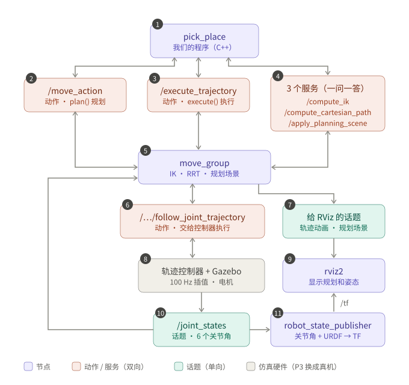
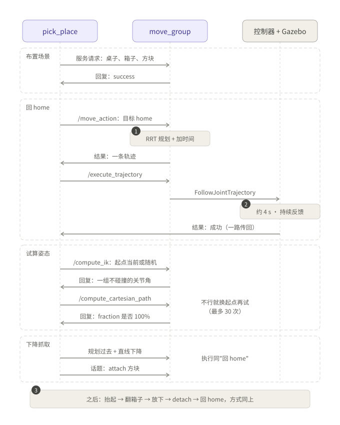
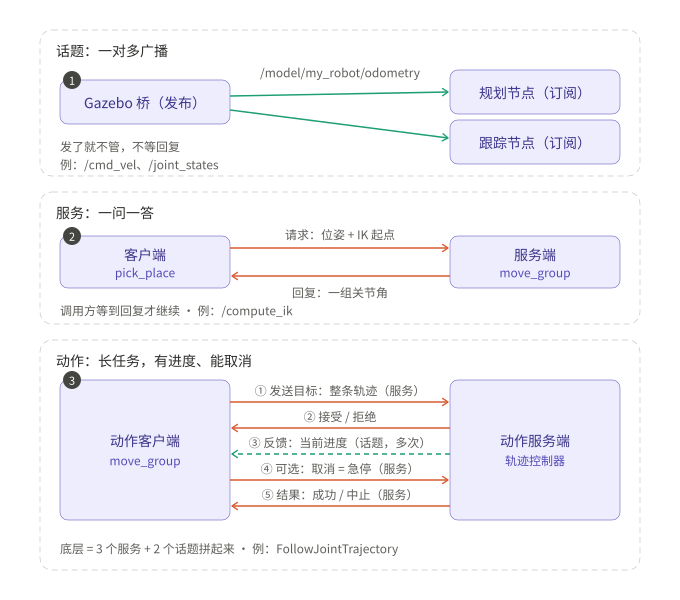

# P2 项目文档：E6 机械臂仿真与 MoveIt 2 运动规划

> 读法建议：分 2–3 次读。第 1–5 节（整体）→ 第 6 节（模块，一次读 1–2 个）→ 第 7–10 节（经验与面试）。
> 读的时候把不懂的地方记下来，读完至少提 3 个问题。

## 目录
1. [一句话介绍](#1-一句话介绍)
2. [演示效果](#2-演示效果)
3. [系统架构](#3-系统架构)
4. [节点 / 话题 / 文件](#4-节点--话题--文件)
5. [数据流：运行 pick_place 之后发生了什么](#5-数据流运行-pick_place-之后发生了什么)
6. [模块逐个讲解](#6-模块逐个讲解)
7. [关键参数与调参经验](#7-关键参数与调参经验)
8. [踩过的坑](#8-踩过的坑)
9. [局限与改进方向](#9-局限与改进方向)
10. [面试问答](#10-面试问答)
11. [通信图解](#11-通信图解)

---

## 1. 一句话介绍

**口头版（自我介绍时用）：**
> 我在 Docker 里搭了越疆 E6 六轴机械臂的 ROS 2 + MoveIt 2 + Gazebo 仿真环境，用 C++ 的 MoveGroupInterface 写了一套抓取-放置程序：机械臂在有桌子和箱子的场景里，自动规划避障路径，把方块从箱子一侧搬到另一侧。

**简历版：**
> **六轴机械臂运动规划与抓取-放置仿真**（C++ / ROS 2 Humble / MoveIt 2 / Gazebo / Docker）
> - 用 Docker 搭建可复现的 Humble + MoveIt 2 + Gazebo 环境（Dockerfile 分层缓存、WSLg 图形显示、挂载工作区），在其中编译越疆官方 E6 包
> - 基于 MoveGroupInterface 实现预设姿态、末端位姿目标、规划场景避障、笛卡尔直线接近 / 撤离和 attach / detach 的完整抓取-放置序列
> - 针对 IK 多解导致的直线下降失败，设计"候选姿态试算"：多起点求 IK + 预计算笛卡尔路径筛选可行姿态，并加入关节突变安全检查；成功率从约 1/3 提升到连续 5/5

---

## 2. 演示效果

（演示视频暂未录制）

目前可以看到的效果：
- RViz 里：绿色的桌子、箱子和小方块是**规划场景**；机械臂先回 home，从上方直线下降到方块，方块"粘"到手上，翻过箱子，放到另一侧
- Gazebo 里：只有机械臂（规划场景里的物体不会出现在 Gazebo，见第 9 节）

---

## 3. 系统架构

```
┌──────────────────────────── Docker 容器 rnl-arm（Ubuntu 22.04 + Humble）─────────────────────────────┐
│                                                                                                      │
│  我们的程序 pick_place（e6_motion 包）                                                                 │
│      │  MoveGroupInterface：plan / execute / computeCartesianPath / attach / detach                   │
│      │  服务调用：/compute_ik（试算候选姿态）、/apply_planning_scene（加桌子箱子方块）                  │
│      ▼                                                                                               │
│  move_group（MoveIt 2 总指挥）                                                                        │
│      ├─ 规划场景（机器人 + 桌子 + 箱子 + 方块）                                                          │
│      ├─ IK 求解器 KDL                                                                                 │
│      └─ 规划器 OMPL RRTConnect                                                                        │
│      │  FollowJointTrajectory（action）                                                              │
│      ▼                                                                                               │
│  me6_group_controller（ros2_control 轨迹控制器，100 Hz）                                               │
│      ▼                                                                                               │
│  硬件接口：mock（M3）/ GazeboSystem（M4、M5）/ 越疆真机驱动（P3）                                        │
│      ▼                                                                                               │
│  joint_state_broadcaster → /joint_states → robot_state_publisher → /tf → RViz                       │
│                                    └──────────→ move_group（知道"现在在哪"）                          │
└──────────────────────────────────────────────────────────────────────────────────────────────────────┘
        ↑ 挂载 ../arm_ws（代码和编译结果在 WSL 里，容器删了也不丢）     ↑ WSLg：RViz / Gazebo 窗口画到 Windows
```

**和 P1 的对应关系：**

| P1 小车 | P2 机械臂 |
|---|---|
| 规划节点（A\*） | move_group（RRTConnect） |
| `/planned_path`：一串 (x, y) | 轨迹：一串"6 个关节角 + 时间" |
| path_follower（P 控制器） | me6_group_controller（轨迹控制器） |
| `/odom` | `/joint_states` |
| GridMap + 膨胀 | 规划场景 + 碰撞检测 |
| RViz 点 2D Goal Pose | 代码里 setPoseTarget / RViz 拖小球 |

---

## 4. 节点 / 话题 / 文件

### 4.1 节点

| 节点 | 由谁提供（哪个软件包） | 作用 |
|---|---|---|
| `move_group` | MoveIt 2 | 接收目标，做 IK、规划、碰撞检测，把轨迹交给控制器 |
| `robot_state_publisher` | ROS 2 | 读 URDF + `/joint_states`，发布每个 link 的 TF |
| `controller_manager`（Gazebo 插件里） | ros2_control | 管理两个控制器 |
| `me6_group_controller` | ros2_control | 接收轨迹，每 10 ms（100 Hz）在轨迹点之间插值出一个目标角度，发给硬件 |
| `joint_state_broadcaster` | ros2_control | 把硬件里的关节角发布到 `/joint_states` |
| `rviz2` | ROS 2 | 显示 + MotionPlanning 交互面板 |
| `move_demo` / `scene_demo` / `pick_place` | **我们写的** | 用代码控制机械臂 |

### 4.2 话题 / 服务 / 动作

| 名字 | 类型 | 方向 | 说明 |
|---|---|---|---|
| `/joint_states` | 话题 `sensor_msgs/JointState` | 控制器 → 所有人 | 6 个关节当前角度 |
| `/tf` | 话题 | robot_state_publisher → RViz 等 | 每个 link 的位置 |
| `/me6_group_controller/follow_joint_trajectory` | **动作** | move_group → 控制器 | 执行一条轨迹，有进度反馈、可取消 |
| `/move_action` | 动作 | 我们的程序 → move_group | MoveGroupInterface 的 plan / move 走这里 |
| `/compute_ik` | 服务 | 我们的程序 → move_group | 给位姿求关节角（可选是否检查碰撞） |
| `/compute_cartesian_path` | 服务 | 我们的程序 → move_group | 算直线路径（computeCartesianPath 内部） |
| `/apply_planning_scene` | 服务 | 我们的程序 → move_group | 往规划场景里加物体 |

### 4.3 坐标系

`dummy_link`（规划坐标系，和底座重合）→ `base_link` → `Link1` … `Link6`（末端法兰）。
关节轴：joint1 竖直（腰），joint2 / 3 / 4 三根水平且互相平行（肩、肘、腕 1），joint5（腕 2），joint6（法兰自转）。大臂 0.189 m，小臂 0.16 m。

### 4.4 文件

| 文件 | 内容 |
|---|---|
| `docker/Dockerfile` | 镜像配方：ubuntu:22.04 + 清华源 + Humble + MoveIt 2 + Gazebo Classic + 普通用户 dev(UID 1000) |
| `docker/compose.yaml` | 容器配置：挂载、显示、软件渲染、`DOBOT_TYPE=me6`、`ROS_DOMAIN_ID=42`、`init: true` |
| `arm_ws/src/DOBOT_6Axis_ROS2_V4/` | 越疆官方包（不提交，按 README 克隆） |
| `arm_ws/src/e6_motion/src/move_demo.cpp` | 第一步：预设姿态 + 末端位姿目标 |
| `arm_ws/src/e6_motion/src/scene_demo.cpp` | 第二步：桌子 + 箱子，翻过箱子 |
| `arm_ws/src/e6_motion/src/pick_place.cpp` | 第三步：抓取-放置序列 |
| `arm_ws/src/e6_motion/include/e6_motion/scene_utils.hpp` | 造长方体、往规划场景加物体（带超时重试） |
| `arm_ws/src/e6_motion/launch/move_demo.launch.py` | 启动我们的程序，`demo:=` 选哪个，`use_sim_time:=` 选时钟 |

---

## 5. 数据流：运行 pick_place 之后发生了什么

1. **加载机器人模型**：launch 把 URDF / SRDF / 运动学参数传给节点，`MoveGroupInterface` 知道规划组 `me6_group`（dummy_link → Link6）和预设姿态 `home`
2. **开 spin 线程**：之后所有"等结果"的调用都在主线程阻塞，回调由这个线程处理
3. **布置场景**：调 `/apply_planning_scene`，加入桌子、箱子、方块（只在 MoveIt 的"地图"里）
4. **回 home**：`setNamedTarget("home")` → `plan()`（RRT 在关节空间找路）→ `execute()`（发 FollowJointTrajectory action → 控制器 → Gazebo 关节动起来 → `/joint_states` 回来）
5. **接近方块**：
   - **试算**：以当前姿态 + 随机起点求 IK（`/compute_ik`，检查碰撞），对每个候选姿态试算 10 cm 直线下降（只计算不执行）；第一个"100% 可行、关节转动 < 90°"的胜出
   - 规划到这个姿态（关节目标）→ 执行
   - 直线下降 10 cm（`computeCartesianPath`，朝向保持当前的）→ 执行前再做一次安全检查 → 执行
6. **抓**：`attachObject("cube", "Link6")`，方块变成机器人的一部分
7. **直线抬起** 10 cm
8. **翻过箱子到放置点**：同第 5 步（试算 → 规划 → 直线下降）；这次规划会把手里的方块也算进碰撞检测
9. **放**：`detachObject("cube")`，方块留在放置点
10. **直线抬起 → 回 home**；所有步骤用 `&&` 串起来，任何一步失败后面都不执行，程序返回 1

---

## 6. 模块逐个讲解

### 6.1 Docker 环境（Dockerfile / compose.yaml）

**作用：** 越疆官方包只支持 Ubuntu 22.04 + Humble，主系统是 26.04 + Lyrical。容器 = 电脑里一个独立的 22.04。

**关键设计：**
- **镜像 vs 容器 = 类 vs 对象**。镜像只读；容器是运行中的实例，删了就没。
- **分层缓存**：每个 `RUN` 一层。改了某一层，它和它之后的层都要重建 → 很少改的放前面；ROS 安装拆成几个 RUN，下载断了不用全部重来。
- **清理写在同一个 RUN 里**（`rm -rf /var/lib/apt/lists/*`）：后面的层删不掉前面层里的文件。
- **挂载** `../arm_ws:/home/dev/arm_ws`：代码和编译结果放在 WSL，容器只是"运行环境"。
- **UID 1000 的普通用户**：容器里编译出的文件在 WSL 里属于你，不是 root。
- **`ROS_DOMAIN_ID=42`**：和主系统的 Lyrical 隔开，两个 ROS 版本不会互相收到消息。
- **`init: true`**：回收退出的子进程，避免僵尸进程越积越多。
- **一个后台容器 + 多次 `exec`**：ROS 要开好几个终端，它们必须在**同一个**容器里。

### 6.2 机器人模型：URDF / SRDF / TF

- **URDF**：link（零件：外形、质量、碰撞形状）+ joint（连接：parent、child、`origin`、`axis`、`limit`）。`origin` = 子坐标系相对父坐标系平移 xyz、旋转 rpy；每个 link 的坐标系原点就在连接它的关节上。
- **SRDF**（MoveIt 用）：规划组 `me6_group`、预设姿态 `home`、哪些 link 之间不用检查碰撞（相邻零件本来就贴着）。
- **TF**：`robot_state_publisher` 用 URDF 的固定 `origin` + 实时关节角，算出每个 link 相对父 link 的变换并发布。fixed 关节发一次静态 TF，转动关节持续发动态 TF。

### 6.3 正运动学与齐次矩阵（P2 手写题的基础）

- 把"旋转 R + 平移 t"装进一个矩阵 `T = [R t; 0 1]`，点写成 (x, y, z, 1)：**补的那个 1 负责把平移带进来**。
- 坐标系一节接一节 → **矩阵连乘**：`p_底座 = T1 · T2 · … · T6 · p_末端`。
- 每个关节的 T = URDF `origin` 那一段（固定）× 绕 `axis` 转关节角那一段（变化）。
- 验收数据：全部关节归零时，Link6 在 base_link 下 = **(−0.133, 0, 0.617)**。

### 6.4 MoveIt 2 架构

- **move_group**：总指挥。
- **IK 求解器 KDL**：末端位姿 → 6 个关节角。**FK 唯一，IK 可能多解、无解**。
- **规划场景**：机器人 + 环境物体，用来查碰撞。
- **OMPL RRTConnect**：6 维关节空间用不了 A\* 的格子（每轴 100 份就是 10¹² 格），改用随机采样：两棵树分别从起点、终点长，连上就找到了；之后再做路径简化和加时间（速度、加速度限制）。所以空场景下两次规划结果差不多（简化后都收敛到"直接走过去"）。

### 6.5 ros2_control 与 action

- **控制器 / 硬件接口分层**：MoveIt 和 `me6_group_controller` 不变，只换硬件接口（mock → GazeboSystem → 真机），上层一行不改。
- **执行轨迹用 action**：话题发了不知道结果；服务会一直阻塞到执行完、中途看不到进度、也停不下来；action 发目标 → 进度反馈 → 结果，**可以随时取消（急停）**。
- Gazebo 里所有节点 `use_sim_time: true`，以仿真时钟为准。

### 6.6 move_demo：用代码代替 RViz 按钮

| RViz 操作 | 代码 |
|---|---|
| 拖小球 | `setPoseTarget(pose)` |
| 选预设姿态 | `setNamedTarget("home")` |
| Plan / Execute | `plan(plan)` / `execute(plan)` |
| Velocity Scaling | `setMaxVelocityScalingFactor(0.2)` |

**为什么要单独开线程 spin：** `plan()` / `execute()` 是阻塞调用，它们等的结果要靠回调送回来。只有主线程的话，它卡在等待上、没空 spin，回调执行不了 → **死锁**。

**够不着的目标**（x = 0.60，超出臂展约 0.45 m）：IK 无解 → `plan()` 返回失败 → 程序停在原地。RViz 拖小球时"停在最远处"是 RViz 交互功能的行为，不是 MoveIt 规划的行为。

### 6.7 scene_demo：规划场景与避障

- `makeBox()` 造长方体碰撞体，`applyCollisionObjects()` 加进场景。
- A、B 两点在箱子两侧，规划器自动"翻过去"：对轨迹每个点做一次 FK（`RobotState::setJointGroupPositions` + `getGlobalLinkTransform`），末端最高约 0.46 m，高于箱顶 0.32 m。
- **规划场景 ≠ 仿真世界 ≠ 真实世界**：场景里没有的东西，机械臂会直接撞上去。

### 6.8 pick_place：抓取-放置

**两种运动：**
- **关节空间规划**（`plan`）：只保证起点、终点，中间是弧线 → 大范围移动、绕障碍物。
- **笛卡尔路径**（`computeCartesianPath`）：末端严格走直线 → 靠近 / 离开物体。返回值 `fraction` = 直线中可行的比例，必须接近 1.0 才执行。

**attach / detach：** 抓起后方块"挂"到 Link6 上，规划时一起做碰撞检测；放下后重新变回环境物体。

**候选姿态试算 `findApproachJoints()`（本项目最关键的设计）：**
1. 调 `/compute_ik`（`avoid_collisions = true`）求候选关节角。KDL 是**迭代**求 IK：从一组"初始猜测"的关节角出发一步步修正，收敛到离它最近的那个解。第 1 次用当前姿态作初始猜测（得到最像当前姿态的解），之后每次随机给一组初始猜测，就能找到**不同的**解
2. `setStartState(候选)` 后调 `computeCartesianPath` 试算直线下降（只算不执行）
3. `fraction ≥ 0.99` 且所有关节转动 ≤ 90° → 选它；最多试 30 个
4. `setJointValueTarget(候选)` → 规划过去 → 再真正执行直线下降

**其他保护：** 直线执行前再查一次关节转动；规划失败重新规划（最多 3 次）；开头先 `detachObject` 防止上次中途失败时方块还挂在手上。

### 6.9 改一个功能（第 ⑥ 步，自己改）

**功能 A：速度缩放做成 launch 参数**
- 命令行 `velocity_scaling:=0.5` → launch 用 `ParameterValue(..., value_type=float)` 转成小数传给节点 → C++ `get_parameter_or("velocity_scaling", 0.2)` 读出
- `std::clamp(值, 0.05, 1.0)` 限幅，速度和加速度用同一个值；**默认值 0.2 必须安全**（忘了传参数的人得到最慢的行为）
- 实测（mock）：0.1 → 81 s，0.2 → 40 s，0.5 → 21 s，传 5 被限制为 1.0 → 18 s。速度越快提升越小：程序里有不随速度变化的固定时间（启动、加载、规划、试算），即阿姆达尔定律

**功能 B：按编号分拣两个方块**
- 数据分两份：`std::vector<Cube>`（桌上有什么：名字、编号、抓取位置）和 `std::map<int, Point2>`（分拣规则：编号 → 放置位置）。改规则只动 map，换方块只动 vector
- 查规则用 `find`，不用 `[]`（`[]` 查不到时会悄悄插入默认值）；查不到就报错停止
- 动作积木一个没改，main 里对每个方块循环"接近 → attach → 抬起 → 翻箱子 → 放下 → detach → 抬起"；`ok = ok && ...` 保证任一步失败后面都不执行
- 搬一个方块时，另一个方块也是规划场景里的障碍物；mock 测试 3/3 成功

---

## 7. 关键参数与调参经验

| 参数 | 当前值 | 改大 / 改小会怎样 |
|---|---|---|
| 速度 / 加速度缩放 | 0.2 / 0.2 | 越大越快；真机第一次上要 0.1–0.2 |
| 规划时间 `setPlanningTime` | 10 s | 太小有障碍时找不到路；太大失败时要等很久 |
| 规划次数 `setNumPlanningAttempts` | 5 | 多次规划取最好，越大路径越好但越慢 |
| 笛卡尔 `eef_step` | 0.005 m | 越小直线越"直"、点越多、算得越慢 |
| 直线允许的最大关节转动 | 90° | 10 cm 直线正常约 33°；设太小会误拒正常路径，太大会放过 IK 跳解 |
| 候选姿态数 `kMaxCandidates` | 30 | 实测 1–3 个就能找到；位置越刁钻需要越多 |
| 抓取高度 | 方块顶上 6 cm（假想夹爪长度） | 有了真夹爪要按 TCP（工具中心点）重新算 |
| 箱子厚度 | 8 cm | 4 cm 时规划器的分段碰撞检查会漏掉（见第 8 节） |

---

## 8. 踩过的坑

| # | 现象 | 原因 | 解决 |
|---|---|---|---|
| 1 | 拉 `osrf/ros` 大镜像反复失败 | Docker Hub 慢、国内镜像站中途报错 | `FROM ubuntu:22.04` + 清华 apt 源装 ROS |
| 2 | 构建时近 1000 个包下载失败 | 代理下 http 80 端口超时 | 装好证书后源改 https |
| 3 | RViz 一启动就崩溃（exit -11） | 22.04 的 Mesa 太旧，走 WSL GPU（D3D12）出错 | `LIBGL_ALWAYS_SOFTWARE=1` 软件渲染 |
| 4 | `ros2 launch` 报找不到 dobot 包 | 在 WSL 主系统里运行，没进容器 | 看提示符：`dev@docker-desktop` 才是容器 |
| 5 | Gazebo 控制器加载失败 | 两套 launch 同时运行，两个同名 controller_manager 冲突；还有残留僵尸进程 | 同一时间只跑一套；`init: true`；必要时重建容器 |
| 6 | RViz 里点 Plan 小球跳回、不规划 | 测试残留的 gzserver 占着端口，新 Gazebo 起不来，环境混在一起 | 重建容器；测完 `docker compose restart` |
| 7 | 直线下降只完成 30%，或某关节突然转 360° | **IK 多解**：规划器随机挑的姿态不适合直线运动，IK 跳到另一组解 | 候选姿态试算 + 关节突变安全检查 |
| 8 | 偶尔"规划成功"但被验证拒绝（Invalid states） | 4 cm 薄墙夹在规划器两个碰撞检查点之间被漏掉 | 加厚到 8 cm + 规划失败重试 |
| 9 | 程序运行后没有任何输出、卡住 | `PlanningSceneInterface::applyCollisionObjects` 偶尔等不到回复 | 自己的服务客户端 + 5 秒超时重试 |

**排查方法（第 7 条）：** 先后猜过"四元数正负号""状态过时""IK 超时"，都用实验排除；最后**打印每个关节的起点和终点数值**，才看出是 joint1 从 −222° 跳到 138°（差 360°）。教训：**猜不中时，直接把数据打印出来看。**

---

## 9. 局限与改进方向

- **没有夹爪**：用 attach / detach 模拟，Gazebo 里也没有真实的物理抓取。→ P5 接入夹爪，Gazebo 里加摩擦 / 抓取插件。
- **规划场景是手写的**：真机旁边多了东西，机械臂不知道。→ 接深度相机，用 MoveIt 的 Octomap 把点云实时变成障碍物（M3 日志里 "No 3D sensor plugin" 说的就是这个功能）。
- **Gazebo 里没有桌子和箱子**：两个"世界"要自己保持一致（和 P1 的 YAML / SDF 一样）。→ 同一份配置同时生成规划场景和 Gazebo 世界。
- **IK 用的是 KDL（数值迭代）**：慢、偶尔求不出、多解时随机。→ 换 TRAC-IK / bio_ik，或者针对 E6 的几何结构写解析 IK。
- **直线运动依赖试算 + 重试**：→ 用 Pilz 工业运动规划器的 LIN（直线）/ PTP（点到点），结果确定、不随机；或者用 MoveIt Task Constructor 把"接近-抓取-撤离"写成一个整体任务。
- **软件渲染**：Gazebo 很慢。→ 升级 Mesa 或换支持 GPU 的方案。

---

## 10. 面试问答

**Q1. 正运动学和逆运动学有什么区别？哪个难？**
FK：关节角 → 末端位姿，矩阵连乘，唯一解。IK：末端位姿 → 关节角，可能多解（6 轴最多 8 组，加上关节能转一圈以上还会更多）、无解（够不着）、或无穷多解（奇异位形）。IK 更难，常用数值迭代（KDL）或解析解。

**Q2. 齐次变换矩阵为什么是 4×4？**
3×3 只能表示旋转，平移是"加一个常数"，矩阵乘法做不到。给点补一个 1，把平移放在第 4 列，旋转 + 平移就变成一次矩阵乘法，坐标系串联就是矩阵连乘。

**Q3. MoveIt 为什么用 RRT 而不用 A\*？**
机械臂在 6 维关节空间规划，网格法的格子数是指数级（每轴 100 份就是 10¹²），搜不完。RRT 随机采样，不需要把空间离散化，对高维空间有效；代价是结果随机、不是最优，所以后面还要做路径简化。

**Q4. 话题、服务、动作有什么区别？执行轨迹为什么用动作？**
话题：单向数据流，发了不管。服务：一问一答，调用方阻塞到返回。动作：目标 → 持续反馈 → 结果，可以取消。执行轨迹耗时几秒，需要进度，更需要能中途取消（急停），所以用动作。

**Q5. ros2_control 的分层有什么好处？**
控制器（算法）和硬件接口（执行者）分开。仿真里用 mock / Gazebo，上真机只换硬件接口，MoveIt 和控制器配置都不用改，仿真代码能直接搬到真机。

**Q6. MoveGroupInterface 为什么要另开一个线程 spin？**
plan / execute 是阻塞调用，等的结果靠回调送回。单线程时主线程卡在等待里没法 spin，回调永远不执行 → 死锁。

**Q7. 关节空间规划和笛卡尔路径分别用在哪？**
关节空间规划只保证起终点，中间末端走弧线、每次不同，适合大范围移动和绕障碍物。笛卡尔路径末端走直线、可预测，适合靠近 / 离开物体、插装、焊接这类对末端轨迹有要求的动作。

**Q8. computeCartesianPath 返回的 fraction 是什么？小于 1 怎么办？**
直线上能求出 IK 且不碰撞的比例。小于 1 说明中途卡住（碰撞、关节极限、IK 失败），不能直接执行半截。处理：换起始姿态重试、调整目标、或者改用普通规划。

**Q9. 抓取时直线下降经常失败，你怎么排查和解决的？**（本项目最好的故事）
现象：同样的程序有时成功，有时直线只走到 30%，或某关节突然转 360°。依次排除了四元数符号、状态过时、IK 超时；打印每个关节起止数值后发现，规划器到达上方时挑了"底座多转一圈、大臂向后折"的姿态，直线下降时 IK 跳回正常姿态。根因是 IK 多解。解决：到达前先生成多个候选姿态（多起点 + 碰撞检查），逐个试算直线路径，选 100% 可行、关节转动正常的；执行前再做关节突变检查。成功率从约 1/3 到连续 5/5。

**Q10. attach 的作用？**
告诉 MoveIt 物体现在跟着末端一起动、算作机器人的一部分，之后规划会把手里的物体一起做碰撞检测。不 attach 的话 MoveIt 以为物体还在原处，搬运时不考虑它，可能撞上别的东西。它不负责"抓牢"，真机上抓牢靠夹爪。

**Q11. 规划场景里有障碍物，Gazebo 里没有，为什么？真机上要注意什么？**
规划场景是 MoveIt 内部的"地图"，Gazebo / 现实是另一个世界，二者需要自己保持一致。真机旁边有东西而场景里没有，机械臂会直接撞上去。办法：场景严格对齐现实，或者接深度相机实时更新（Octomap）。

**Q12. 为什么用 Docker？遇到过什么问题？**
官方包只支持 Humble，用容器不用重装系统、环境可复现、方便迁移到别的电脑。问题：大镜像拉不下来（改从 ubuntu:22.04 + 国内 apt 源构建）、容器 GUI 显示（WSLg + 软件渲染）、容器里多个 launch 冲突和僵尸进程（init + 一次只跑一套）。

**Q13. 仿真上真机前，你会检查什么？**
速度比例降到 10–20%；先在仿真跑通同一个程序；确认规划场景和真实环境一致；手放在急停上；第一次运行观察每一步再继续；确认工具坐标系（TCP）和真实夹爪一致。

**Q14. 这个项目还能怎么改进？**
见第 9 节：真夹爪、相机感知、确定性的工业规划器（Pilz LIN / PTP）、更好的 IK 求解器、MoveIt Task Constructor。

**Q22. 把速度做成参数时要注意什么？**
不用改代码、不用重新编译就能调速；参数要限幅（MoveIt 要求 (0, 1]）；默认值必须是安全的低速；速度和加速度一起缩放。速度翻倍不等于总时间减半，固定开销（启动、规划、试算）不受影响。

**Q23. 分拣规则为什么用 std::map，查找为什么用 find 而不是 []？**
规则是"按编号查位置"，map 正好是按键查值；和方块列表分开存，改规则不影响方块数据。`[]` 在键不存在时会插入一个默认值、不报错，导致错误悄悄发生；`find` 返回 end() 时可以明确报错停止。

### 追问专题（来自读文档时自己提的问题）

**Q15. 既然有 RRT，为什么还要 KDL？两者怎么分工？**
KDL 是"翻译官"：把"手要到哪里"（末端位姿）翻译成"6 个关节角"。RRT 是"找路的人"：起点、终点都是关节角，在关节空间里找一条不碰撞的路；找路时直接撒关节角、用 FK 查碰撞，**中间点不需要 KDL**。`setNamedTarget` 只用 RRT；`setPoseTarget` 先用 KDL 解终点再用 RRT；`computeCartesianPath` 只用 KDL（每 5 mm 解一次），不用 RRT。小车不需要"翻译"，因为它的目标 (x, y) 和规划空间是同一个。

**Q16. 直线下降为什么用 KDL 逐点求解，而不让 RRT 找路？**
直线的路线已经定了，不需要"找"：RRT 只保证不碰撞，不管路线形状，随机撒点恰好落在直线上的概率几乎为零。直接把直线切成 5 mm 一段、逐点求 IK，再检查可行比例 fraction 即可。

**Q17. 抓取-放置这种分段任务是怎么规划的？**
MoveIt 一次只规划一段，"分段"由程序负责：main 里用 `&&` 串起 回 home → 接近 → 下降 → attach → 抬起 → 翻箱子 → 下降 → detach → 抬起 → 回 home；每段从上一段结束时的实际姿态开始规划，失败则后续都不执行。整体规划任务可以用 MoveIt Task Constructor。

**Q18. RRT 怎么排除"直接穿过箱子"的路径？**
不是先画整条路再判断，而是每长一小步就检查：沿这一步每隔一小段取一个姿态，用 FK 算出每节手臂（含手里的方块）的位置，和场景物体做几何相交检测，撞了这一步就丢弃，穿箱子的路根本进不了树。找到路后整条路再验证一次。检查是"隔一段一次"，所以太薄的障碍物可能被漏掉。

**Q19. 动作通信是异步的，为什么 `execute()` 会阻塞？**
通信方式和函数用法是两个层面：动作本身发完目标就返回、结果稍后通过回调送回；`execute()` 是封装好的"省事版"，发出目标后自己选择等结果。顺序任务这样写最简单；需要边执行边监控（比如发现有人就急停）时用 `asyncExecute()` + `stop()`。

**Q20. 轨迹控制器为什么按 100 Hz 插值发位置命令？**
MoveIt 给的轨迹点很稀疏（约 0.1 s 一个、间隔不均），电机需要连续平滑的命令。控制器每 10 ms 根据当前时刻在相邻两个轨迹点之间做样条插值，算出此刻应在的角度发给硬件，硬件自己的伺服负责转到位。规划（大致路线）和控制（每一刻在哪）分工，100 Hz 是平滑度和计算量的折中（配置 `update_rate: 100`）。

**Q21. KDL 迭代求 IK 时，"初始猜测"有什么影响？**
迭代法从初始猜测出发，每步只在当前角度附近修正误差，所以收敛到离初始猜测最近的那组解。两节臂到 (1, 1)：从 (20°, 60°) 出发收敛到 (0°, 90°)，从 (70°, −60°) 出发收敛到 (90°, −90°)。默认用当前姿态作初始猜测；pick_place 里第 1 次用当前姿态、之后随机，就是为了找出多组不同的解来试算。

---

## 11. 通信图解

> 图中的数字徽章对应下面的同号问答。图在 `docs/media/comm/`。

### 11.1 谁和谁在通信：话题、服务、动作



1. **pick_place 里，MoveGroupInterface 的函数分别对应哪个通信？**
   `plan()` → `/move_action` 动作（只规划不执行）；`execute()` → `/execute_trajectory` 动作；`computeCartesianPath()` → `/compute_cartesian_path` 服务；`attachObject()` / `detachObject()` → `/attached_collision_object` 话题。我们自己写的试算和布置场景，直接调 `/compute_ik`、`/apply_planning_scene` 服务。
2. **`/move_action` 的目标、反馈、结果分别是什么？**
   目标：规划组 `me6_group`、起点（当前状态）、目标约束（关节角或位姿）、速度比例、规划时间，以及"只规划"标志。反馈：当前阶段（规划中、监控中……）。结果：错误码（1 = SUCCESS）、规划出的轨迹、用时。
3. **`/execute_trajectory` 是怎么把轨迹交给控制器的？**
   我们把 plan 得到的轨迹作为目标发给 move_group；move_group 的轨迹执行管理器按 `moveit_controllers.yaml` 找到负责这 6 个关节的控制器 `me6_group_controller`，向它发 FollowJointTrajectory 动作、监控执行，结束后把结果传回给我们。
4. **三个服务的请求和回复里分别有什么？**
   `/compute_ik`：请求 = 规划组 + 末端位姿 + 初始猜测 + 是否检查碰撞 + 超时；回复 = 错误码 + 一组关节角。`/compute_cartesian_path`：请求 = 起始状态 + 路点 + 步长（5 mm）；回复 = 轨迹 + fraction（直线中可行的比例）。`/apply_planning_scene`：请求 = 要加入的物体（形状、尺寸、位置）；回复 = success。
5. **move_group 内部是怎么组织的？**
   一个节点里拼装了一组插件：KDL 插件做 IK，OMPL 插件做规划（RRTConnect），规划前后有一串"请求适配器"（修正起点、加时间参数等）；PlanningSceneMonitor 维护规划场景（订阅 `/joint_states` 更新姿态、接收我们加的物体）并做碰撞检测；TrajectoryExecutionManager 管执行。插件和参数都来自 `me6_moveit` 配置包。
6. **FollowJointTrajectory 的目标、反馈、结果是什么？为什么急停要靠取消？**
   目标：关节名 + 一串轨迹点（每点 6 个角度、速度、到达时刻）。反馈：期望位置、实际位置、误差。结果：错误码（成功、跟踪误差过大、被取消等）。执行要好几秒，只有动作能在中途取消：发出取消后控制器停止跟随轨迹、保持当前位置，这就是软件层面的"急停"。
7. **给 RViz 的话题 `/display_planned_path` 和 `/monitored_planning_scene` 是什么？**
   `/display_planned_path`：每次规划成功，move_group 把轨迹发出来，RViz 播放成半透明机械臂动画（"白色虚影"之一）。`/monitored_planning_scene`：move_group 维护的整个场景（机器人当前姿态 + 桌子、箱子、方块 + 抓着的物体），RViz 照着画出来。
8. **轨迹控制器怎么 100 Hz 插值、驱动 Gazebo 里的电机？**
   controller_manager 每 10 ms 调用一次 `me6_group_controller`：按当前时刻在相邻两个轨迹点之间做样条插值，算出 6 个关节此刻应在的角度，写入 position 命令接口；`gazebo_ros2_control` 插件把命令交给 Gazebo 里的关节，再把实际角度和速度读回状态接口。P3 换成越疆的 `action_move_server`，逐点发 ServoJ 指令给真机。
9. **RViz 显示的机械臂姿态是从哪来的？**
   实际姿态：`/joint_states` → robot_state_publisher → `/tf`，再加上 move_group 的规划场景。规划动画来自 `/display_planned_path`。拖动小球时的橙色目标，是 RViz 的 MotionPlanning 插件自己求 IK 得到的，和我们的程序无关。
10. **`/joint_states` 里有什么？move_group 为什么必须订阅它？**
    6 个关节的名字、角度、速度，由 `joint_state_broadcaster` 从硬件状态接口读出后发布（P3 里由驱动从 30004 端口解析）。move_group 靠它知道"现在在哪"：规划的起点、直线路径的起点、`getCurrentPose()` 都依赖它；收不到的话，规划会从错误的起点开始。
11. **robot_state_publisher 怎么用 URDF 和关节角算出 TF？**
    启动时读 URDF，记下每个关节的固定 origin 和转轴；每收到一次 `/joint_states`，就对每个关节算"origin × 绕轴转关节角"，把每一节相对父节点的变换发到 `/tf`（fixed 关节只发一次到 `/tf_static`）。这正是手写 FK 里每个关节的那一步；它不做连乘，连乘由使用 TF 的一方去做。

### 11.2 抓一个方块的消息时序



1. **move_group 收到规划目标后，"RRT 规划 + 加时间"具体做了什么？**
   RRTConnect 在 6 维关节空间里从起点、终点各长一棵随机树，连上后得到一串关节角（还没有时间）；接着简化路径，剪掉多余拐点；最后做"时间参数化"（AddTimeOptimalParameterization）：按关节速度、加速度上限 × 我们设的缩放比例，给每个点算出到达时刻和速度，轨迹才能执行。
2. **执行中的反馈是什么？中途取消会怎样？**
   反馈里有每个关节的期望角度、实际角度和误差，move_group 用它监控执行（误差太大会判定失败）。取消时控制器停止跟随轨迹、保持当前位置，结果返回"已取消"，我们的 `execute()` 返回失败，`&&` 链后面的步骤都不再执行。
3. **抓住之后，抬起、翻箱子、放下、detach 各用了哪种通信？**
   抬起和放下：`computeCartesianPath`（服务）+ `execute`（动作）。翻箱子：先试算（`/compute_ik`、`/compute_cartesian_path` 服务），再 `plan`（`/move_action`）+ `execute`（`/execute_trajectory` → FollowJointTrajectory）。detach：`/attached_collision_object` 话题。回 home：`plan` + `execute`。

### 11.3 原理：话题、服务、动作

所有节点在同一个 `ROS_DOMAIN_ID` 里（P2 的容器设为 42），通过 DDS 中间件自动发现彼此；话题名、消息类型、QoS 都对得上，才会连通。



1. **话题的发布者怎么知道有哪些订阅者？DDS 自动发现是怎么回事？**
   发布者不需要知道。每个节点启动时，DDS 在同一个 `ROS_DOMAIN_ID` 的网络里广播"我是谁、发布 / 订阅哪些话题、什么类型"，彼此记下能匹配的对象，之后数据直接点对点发送。话题名、消息类型、QoS 任何一项不匹配，都会"静默收不到"，不报错。
2. **服务调用时客户端为什么会阻塞？什么情况适合用服务？**
   服务就是"发请求、等回复"，调用函数通常要等回复到了才返回，所以调用方停在那一行（我们的 `solveIk` 用 `future.wait_for` 加了 2 秒超时，防止一直等下去）。适合很快能答完、又必须拿到答案才能继续的事：查询、计算（IK）、修改配置（往场景里加物体）。耗时长的任务用动作。
3. **动作底层是由哪几个服务和话题组成的？**
   3 个服务：`send_goal`（发目标，回复接受 / 拒绝）、`cancel_goal`（取消）、`get_result`（取结果）；2 个话题：`feedback`（进度，多次）、`status`（各个目标的状态）。动作就是把这 5 个通信按约定组合起来，客户端库替你管理目标从发出到结束的整个过程。

---

## 附录：命令速查

```bash
# 进容器（每个终端都要先执行；提示符变成 dev@docker-desktop 才算进去）
cd ~/project/robot-navigation-lab/docker && docker compose up -d && docker compose exec arm bash

# 编译我们的包
colcon build --packages-select e6_motion

# 只看模型 + 关节滑块
ros2 launch dobot_rviz dobot_rviz.launch.py gui:=true

# MoveIt + 假硬件（M3）
ros2 launch dobot_moveit moveit_demo.launch.py

# Gazebo + MoveIt（M4、M5，两个终端）
ros2 launch dobot_gazebo gazebo_moveit.launch.py
ros2 launch dobot_moveit moveit_gazebo.launch.py

# 我们的程序（第三个终端；配 moveit_demo 时加 use_sim_time:=false）
ros2 launch e6_motion move_demo.launch.py demo:=move_demo     # 或 scene_demo / pick_place

# 坐标树、末端位置
ros2 run tf2_tools view_frames
ros2 run tf2_ros tf2_echo base_link Link6

# 容器乱了：重启 / 重建
docker compose restart
docker compose up -d --force-recreate
```
